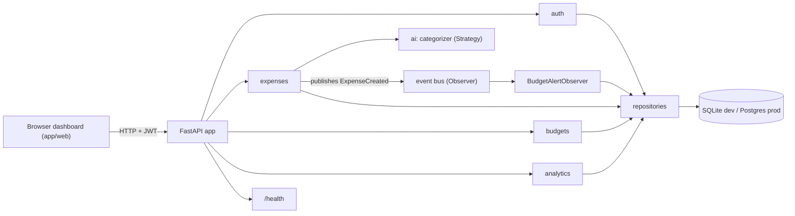
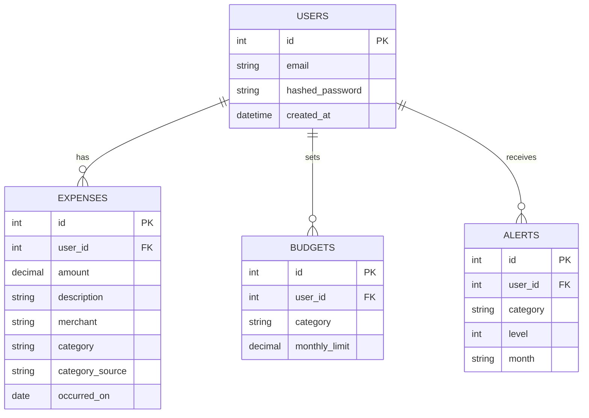

# SpendSmart: Technical Task (single source of truth)

> **Audience:** the 5 team members. Written to be self-contained: every rule, interface, endpoint and task is stated explicitly.
> **How to use it:** read sections 0–6 (shared rules), then your own section in 7.
> **Rule:** if code and this document disagree, fix the document in a PR. Do not silently diverge.

---

## 0. TL;DR

SpendSmart is a **FastAPI** web app. A user types an expense in plain text (`Uber 12.40`). The app parses it, **auto-categorizes** it (Strategy pattern, with rules, ML and LLM options), stores it, checks **budgets** (Observer pattern) and shows **analytics** on a dashboard.

- Language and tooling: Python 3.12, FastAPI, SQLAlchemy 2, **uv** (`uv sync`), pytest, ruff.
- Delivery: GitHub Actions CI, Docker, GHCR, Render auto-deploy, UptimeRobot, rollback.
- Deadline: **final presentation Dec 17 or 18, 2026**. Feature freeze **Dec 10**.
- Course requirement: use every technology from PW#1–8 and show design patterns. Git history is checked, so everyone must have their own branches, commits and PRs.

---

## 1. Team and ownership

| Member | Role | Owns (folders / files) | Branch prefixes |
|---|---|---|---|
| **Farhad** | Backend core, architecture, deploy, monitoring | `app/main.py`, `app/core/*`, `app/models/*`, `app/repositories/*`, `app/health.py`, `tests/conftest.py`, Render and monitoring | `feat/skeleton`, `feat/repository-layer`, `feat/settings`, `feat/core-utils`, `ops/render-deploy`, `ops/monitoring` |
| **Hakim** | CI and containers | `.github/workflows/*`, `Dockerfile`, `.dockerignore`, `docker-compose.yml` | `ci/*`, `docker/*`, `cd/*`; optional `ios/*` |
| **Huseyn** | Core business features | `app/auth/*`, `app/expenses/*`, `app/budgets/*` | `feat/auth`, `feat/expenses`, `feat/budgets`, `feat/budget-alerts` |
| **Maryam** | AI and data | `app/ai/*`, `app/analytics/*`, `data/*` | `feat/categorizer-*`, `feat/analytics`, `data/*` |
| **Sabuhi** | Frontend, tests, docs | `app/web/*`, `tests/` (feature tests), `docs/*` (except this file), `README.md` | `feat/dashboard-ui`, `test/*`, `docs/*` |

**Ownership rule:** only edit files in your own area. If you need a change in someone else's area, open an issue or ask them. This keeps merge conflicts near zero and makes the git history show clear individual contributions (LC05: high cohesion, low coupling).

---

## 2. Architecture

### 2.1 Style (LC05)

A **layered architecture**, one FastAPI application (a modular monolith):

```
Router (HTTP, validation)  ->  Service (business logic)  ->  Repository (DB access)  ->  Database
        ^ Pydantic schemas          ^ patterns live here           ^ SQLAlchemy models
```

- Routers contain no business logic and no SQL.
- Services contain no HTTP objects and no SQL.
- Repositories are the only code that talks to the database.
- Dependencies are injected with FastAPI `Depends` (Dependency Injection, LC07).

### 2.2 Component diagram



### 2.3 Folder layout (target)

```
.
├── app/
│   ├── main.py                 # app factory, include routers, create tables
│   ├── health.py               # GET /health            [Farhad]
│   ├── core/
│   │   ├── config.py           # Settings singleton     [Farhad]
│   │   ├── db.py               # engine, session, Base  [Farhad]
│   │   ├── events.py           # event bus (Observer)   [Farhad]
│   │   ├── monads.py           # Maybe, Writer          [Farhad]
│   │   └── logging.py          # logging setup          [Farhad]
│   ├── models/                 # SQLAlchemy ORM models  [Farhad]
│   │   ├── user.py  expense.py  budget.py  alert.py
│   ├── repositories/           #                        [Farhad]
│   │   ├── base.py  user_repo.py  expense_repo.py  budget_repo.py  alert_repo.py
│   ├── auth/       {router,service,schemas,security}.py [Huseyn]
│   ├── expenses/   {router,service,schemas,parser}.py   [Huseyn]
│   ├── budgets/    {router,service,schemas,observers}.py[Huseyn]
│   ├── ai/         {base,rules,ml,llm,factory}.py       [Maryam]
│   ├── analytics/  {router,service,schemas}.py         [Maryam]
│   └── web/        {router.py, templates/, static/}     [Sabuhi]
├── data/seed_expenses.csv      # labelled examples       [Maryam]
├── tests/                      # mirrors app/ structure
├── docs/                       # TECH_TASK.md, requirements.md, uml/
├── .github/workflows/{ci.yml,cd.yml}                   [Hakim]
├── Dockerfile  docker-compose.yml                       [Hakim]
├── pyproject.toml  uv.lock  README.md
```

Each feature package follows the same shape: `router.py` -> `service.py` -> uses `repositories`, with `schemas.py` for Pydantic models.

---

## 3. Tech stack and dependencies

Install with `uv sync`. Add packages with `uv add <pkg>` (runtime) or `uv add --dev <pkg>`. Only the owner of an area adds dependencies for it, in their own branch. `pyproject.toml` and `uv.lock` change together.

| Purpose | Package | Who adds |
|---|---|---|
| Web | `fastapi`, `uvicorn[standard]` (already added) | Farhad |
| Database | `sqlalchemy>=2`, `psycopg[binary]` | Farhad |
| Settings | `pydantic-settings` | Farhad |
| Auth | `pyjwt`, `bcrypt`, `python-multipart` | Huseyn |
| LLM calls | `httpx` (move from dev to runtime) | Maryam |
| ML (optional) | `scikit-learn` | Maryam |
| Templates | `jinja2` | Sabuhi |
| Tests | `pytest`, `httpx`, `pytest-cov` | Farhad / Sabuhi |
| Lint and format | `ruff` (already added) | Hakim in CI |

Python version is pinned in `.python-version` (3.12).

---

## 4. Domain model

### 4.1 Categories (fixed enum, `app/models/expense.py`)

`Food, Transport, Subscriptions, Shopping, Bills, Health, Entertainment, Other`

Use `str` Enum `Category`. `Other` is the fallback.

### 4.2 Tables

**users**

| column | type | notes |
|---|---|---|
| id | int PK | |
| email | str unique, indexed | lowercase |
| hashed_password | str | bcrypt |
| created_at | datetime (UTC) | |

**expenses**

| column | type | notes |
|---|---|---|
| id | int PK | |
| user_id | FK users.id, indexed | |
| amount | Numeric(12,2) | use `Decimal`, always > 0 |
| description | str | original text without the amount, e.g. "Uber" |
| merchant | str null | optional, defaults to description |
| category | Category | |
| category_source | enum `rules / ml / llm / manual` | who decided |
| occurred_on | date | defaults to today |
| created_at | datetime (UTC) | |

**budgets**

| column | type | notes |
|---|---|---|
| id | int PK | |
| user_id | FK | |
| category | Category | |
| monthly_limit | Numeric(12,2) | > 0 |
| | | unique `(user_id, category)` |

**alerts**

| column | type | notes |
|---|---|---|
| id | int PK | |
| user_id | FK | |
| category | Category | |
| level | int | `80` or `100` |
| month | str `YYYY-MM` | |
| created_at | datetime | |
| | | unique `(user_id, category, level, month)` so an alert fires once per month per level |



---

## 5. Shared contracts (the interfaces everyone codes against)

These are the **only** shared APIs. Farhad ships them first (milestone M1) so the others can work in parallel. Copy signatures exactly.

### 5.1 Settings, a Singleton (`app/core/config.py`)

```python
from functools import lru_cache
from pydantic_settings import BaseSettings

class Settings(BaseSettings):
    app_env: str = "dev"
    database_url: str = "sqlite:///./spendsmart.db"
    jwt_secret: str = "change-me"
    jwt_expire_minutes: int = 60
    categorizer: str = "rules"        # rules | ml | llm | chain
    llm_api_key: str | None = None
    log_level: str = "INFO"

@lru_cache          # one instance per process = Singleton
def get_settings() -> Settings: return Settings()
```

Secrets come only from environment variables or `.env` (git-ignored). Never commit secrets.

### 5.2 Database (`app/core/db.py`)

```python
class Base(DeclarativeBase): ...
engine = create_engine(get_settings().database_url, ...)
SessionLocal = sessionmaker(bind=engine, autoflush=False)
def get_db() -> Iterator[Session]: ...   # FastAPI dependency; yields and closes the session
```

Tables are created at startup with `Base.metadata.create_all(engine)` (no Alembic, to keep the scope small).

### 5.3 Generic Repository (`app/repositories/base.py`)

```python
class Repository(Generic[T]):
    def __init__(self, db: Session, model: type[T]): ...
    def get(self, id: int) -> T | None
    def add(self, obj: T) -> T          # add + flush + refresh
    def delete(self, obj: T) -> None
    def list(self) -> list[T]
```

Concrete repositories extend it with query methods. **All user data queries take `user_id` and filter by it.**

```python
class UserRepository(Repository[User]):
    def get_by_email(self, email: str) -> User | None
class ExpenseRepository(Repository[Expense]):
    def list_for_user(self, user_id, month: str | None = None, category: Category | None = None) -> list[Expense]
    def get_for_user(self, user_id, expense_id) -> Expense | None
    def total_for_month(self, user_id, category: Category, month: str) -> Decimal
    def totals_by_category(self, user_id, month: str) -> dict[Category, Decimal]
    def totals_by_month(self, user_id, months: int) -> list[tuple[str, Decimal]]
    def top_merchants(self, user_id, month: str, limit: int = 5) -> list[tuple[str, Decimal]]
class BudgetRepository(Repository[Budget]):
    def get_for_user(self, user_id, category) -> Budget | None
    def list_for_user(self, user_id) -> list[Budget]
class AlertRepository(Repository[Alert]):
    def exists(self, user_id, category, level, month) -> bool
    def list_for_user(self, user_id) -> list[Alert]
```

Repositories are provided through `Depends` (e.g. `def get_expense_repo(db=Depends(get_db)) -> ExpenseRepository`) in `app/repositories/__init__.py`.

### 5.4 Monads (`app/core/monads.py`), LC08

```python
class Maybe(Generic[T]):
    @staticmethod
    def of(value: T | None) -> "Maybe[T]"        # None -> Nothing
    @staticmethod
    def nothing() -> "Maybe[T]"
    def map(self, f) -> "Maybe"                  # apply f if Just
    def bind(self, f) -> "Maybe"                 # f returns a Maybe
    def get_or_else(self, default: T) -> T
    def is_nothing(self) -> bool

class Writer(Generic[T]):                         # value + log list
    @staticmethod
    def unit(value: T) -> "Writer[T]"
    def tell(self, message: str) -> "Writer[T]"  # append to the log
    def bind(self, f) -> "Writer"                # f returns a Writer; logs are concatenated
    def run(self) -> tuple[T, list[str]]
```

Required tests (Farhad): the three monad laws (left identity, right identity, associativity) for both, plus the `None` case for `Maybe`.

### 5.5 Event bus, Observer (`app/core/events.py`), LC07

```python
@dataclass(frozen=True)
class ExpenseCreated:
    user_id: int
    category: Category
    month: str          # "YYYY-MM"

class EventBus:
    def subscribe(self, event_type: type, handler: Callable) -> None
    def publish(self, event) -> None      # calls every handler of that type, in order

bus = EventBus()   # module-level shared instance
```

A handler exception must be logged and must not break the request.

### 5.6 Categorizer, Strategy (`app/ai/base.py`), LC07

```python
class CategorizerStrategy(Protocol):
    name: str                                            # "rules" | "ml" | "llm"
    def categorize(self, description: str) -> Maybe[Category]: ...
```

Implementations: `RulesCategorizer`, `MLCategorizer`, `LLMCategorizer`, and `ChainCategorizer([...])`, which tries strategies in order and returns the first non-Nothing result.

Factory (`app/ai/factory.py`):

```python
def build_categorizer(kind: str) -> CategorizerStrategy   # "rules" | "ml" | "llm" | "chain"; unknown -> ValueError
def get_categorizer() -> CategorizerStrategy               # FastAPI dependency using get_settings().categorizer
```

LLM Adapter (`app/ai/llm.py`):

```python
class LLMClient(Protocol):
    def complete(self, prompt: str) -> str: ...
class HttpLLMAdapter:   # wraps a real provider over httpx; reads the key from settings
class FakeLLMClient:    # for tests, returns a fixed string, no network
```

**Tests must never call the network.**

### 5.7 Auth dependency (`app/auth/security.py`)

```python
def get_current_user(token=Depends(oauth2_scheme), users=Depends(get_user_repo)) -> User   # raises 401
```

Every non-auth route that returns user data depends on `get_current_user`.

---

## 6. API specification

Base URL local: `http://localhost:8000`. Docs are auto-generated at `/docs`. All bodies are JSON unless stated. Money is a string or number with 2 decimals. Month format is `YYYY-MM`. Errors use FastAPI's `{"detail": "..."}`.

### 6.1 Health (Farhad)

| Method | Path | Auth | Response |
|---|---|---|---|
| GET | `/health` | no | `200 {"status":"ok","db":"ok","version":"0.1.0"}`. If the DB check fails: `503 {"status":"degraded","db":"down",...}` |

The DB check runs `SELECT 1`. UptimeRobot watches this path.

### 6.2 Auth (Huseyn)

| Method | Path | Body | Response |
|---|---|---|---|
| POST | `/auth/register` | `{email, password}` (password >= 8 chars) | `201 {id, email}`; `409` if email exists |
| POST | `/auth/login` | form fields `username` (= email), `password` | `200 {access_token, token_type:"bearer"}`; `401` on bad credentials |
| GET | `/auth/me` | | `200 {id, email}` |

Passwords are hashed with bcrypt. JWT uses HS256 and `jwt_secret` from settings, with the user id in `sub` and expiry from `jwt_expire_minutes`.

### 6.3 Expenses (Huseyn)

| Method | Path | Notes |
|---|---|---|
| POST | `/expenses` | Body is `{"text":"Uber 12.40"}` **or** `{"amount":12.4,"description":"Uber","occurred_on":"2026-11-20","category":"Transport"}`. If `category` is given, `category_source="manual"`. Otherwise the categorizer runs. Returns `201` with the expense. Publishes `ExpenseCreated`. `422` if the text cannot be parsed or the amount is <= 0. |
| GET | `/expenses` | Query: `month`, `category`. Newest first. |
| GET | `/expenses/{id}` | `404` if it does not exist or belongs to another user. |
| PATCH | `/expenses/{id}` | Partial update. Changing `category` sets `category_source="manual"`. |
| DELETE | `/expenses/{id}` | `204`. |

**Text parser** (`app/expenses/parser.py`) returns `Maybe[ParsedExpense]`:
- The amount is the **last** token that parses as a number (`12.40`, `12,40`, `$12.40`, `12.40$`).
- The description is everything else, trimmed.
- Accepted: `"Uber 12.40"`, `"Starbucks latte 6.5"`, `"15 Netflix"` (amount may also be first).
- Not accepted (`Nothing`): empty text, no number, number <= 0.

**Create pipeline** uses `Writer` for an audit log: `parse -> categorize -> save -> publish`. Example log lines: `parsed amount=12.40 desc='Uber'`, `categorized as Transport by rules`, `saved expense id=7`. The final log is written with the `logging` module at INFO.

### 6.4 Budgets (Huseyn)

| Method | Path | Notes |
|---|---|---|
| PUT | `/budgets/{category}` | Body `{monthly_limit}`. Creates or updates. `422` if <= 0. |
| GET | `/budgets` | List the user's budgets. |
| DELETE | `/budgets/{category}` | `204`; `404` if none. |
| GET | `/budgets/status?month=YYYY-MM` | For each budget: `{category, limit, spent, percent, level}` where `level` is `"ok"` (<80), `"warning"` (>=80 and <100) or `"exceeded"` (>=100). Month defaults to the current month. |
| GET | `/alerts` | The user's alerts, newest first. |

**Observer:** `BudgetAlertObserver` (in `app/budgets/observers.py`) subscribes to `ExpenseCreated` at app startup. On each event it computes the month total for that category and compares it with the budget. If percent >= 80 (or >= 100) and no alert exists for `(user, category, level, month)`, it inserts an `Alert` and logs a WARNING. Level 100 is checked first. It does nothing if the user has no budget for that category.

### 6.5 Analytics (Maryam)

All require auth and are computed from the user's expenses.

| Method | Path | Response |
|---|---|---|
| GET | `/analytics/summary?month=` | `{month, total, count, average, top_category}` |
| GET | `/analytics/by-category?month=` | `[{category, total, percent}]`, sorted by total desc; percents sum to 100 |
| GET | `/analytics/trend?months=6` | `[{month, total}]`, oldest first, months with no spending included as 0 |
| GET | `/analytics/top-merchants?month=&limit=5` | `[{merchant, total}]` |

Use the `ExpenseRepository` aggregate methods. Do not load all rows and sum in Python.

### 6.6 Web (Sabuhi)

| Path | Page |
|---|---|
| `GET /` | Dashboard (needs a token in `localStorage`, otherwise redirect to `/login`) |
| `GET /login` | Login and register form |

Static JS calls the JSON API with `Authorization: Bearer <token>`. Charts use Chart.js from a CDN (pinned version). Dashboard must show: add-expense box (single text input), expense list with category edit, budget cards with progress bars (green / amber / red), alerts list, pie chart by category, line chart for the trend.

---

## 7. Per-person tasks

Each task = branch, what to build, acceptance criteria. **Definition of done for every task:** code + tests + ruff clean + PR approved by one other member + CI green.

### 7.1 Farhad

**Branch `feat/core-utils`** (do first, small PR): `app/core/monads.py`, `app/core/events.py`, `app/core/logging.py`. Tests: monad laws, bus publish/subscribe and handler-failure isolation.
**Branch `feat/settings`:** `app/core/config.py` per 5.1. Test that `get_settings()` returns the same object, and that env vars override defaults.
**Branch `feat/repository-layer`:** `db.py`, all models (section 4), `repositories/*` (section 5.3), `tests/conftest.py`.
- `conftest.py` provides an **in-memory SQLite** engine per test, a `db` session fixture, and a `client` fixture (`TestClient`) with `get_db` overridden. Everyone's tests use these.
- Tests: CRUD for each repository, aggregate methods, user-scoping (a user cannot read another user's rows), unique constraints.
**Branch `feat/skeleton`:** `main.py` updated to include routers and create tables on startup (use FastAPI `lifespan`); empty routers for each feature so others can plug in. Add `app/health.py`.
**Branch `ops/render-deploy`** (after Hakim's Dockerfile is merged): Render Web Service (Docker, from the GitHub repo, auto-deploy on `main`), Render Postgres, env vars (`DATABASE_URL`, `JWT_SECRET`, `CATEGORIZER`, `LLM_API_KEY`), health check path `/health`. Document steps and screenshots in `docs/deploy.md`.
**Branch `ops/monitoring`:** structured request logging middleware (method, path, status, duration ms), `/health` DB check, UptimeRobot HTTP monitor (5 min, email alert), and a **rollback runbook** in `docs/runbook.md` (see section 10). Rehearse once and record the result.
**Ongoing:** review PRs for pattern conformance (sections 5 and 9).
**Optional:** AWS deployment (EC2 + `docker compose`, or App Runner from GHCR) as a bonus, only after Render works. Keep Render as the demo fallback.

**Milestone M1 (Nov 13):** `feat/core-utils`, `feat/settings`, `feat/repository-layer`, `feat/skeleton` merged. Until then Huseyn, Maryam and Sabuhi can build against the contracts in section 5 with their own temporary fakes.

### 7.2 Hakim

**Branch `ci/pytest-workflow`** (PW#4): `.github/workflows/ci.yml`, triggered on `pull_request` and `push` to `main`. Steps: checkout, `astral-sh/setup-uv`, `uv sync --frozen`, `uv run ruff check .`, `uv run ruff format --check .`, `uv run pytest --cov=app --cov-fail-under=60`. Cache uv. CI must fail when tests fail (prove it with one deliberately failing PR, then close it).
**Branch `docker/dockerfile`** (PW#5): base `python:3.12-slim`; copy `uv` binary from `ghcr.io/astral-sh/uv`; `uv sync --frozen --no-dev`; non-root user; `CMD uvicorn app.main:app --host 0.0.0.0 --port ${PORT:-8000}`; `HEALTHCHECK` hitting `/health`; `.dockerignore` for `.venv`, `.git`, `__pycache__`, `.env`. Image under ~250 MB.
**Branch `docker/compose`:** `docker-compose.yml` with `app` + `db` (Postgres 16) + env file example `.env.example`. `docker compose up` gives a working app at `localhost:8000`.
**Branch `cd/ghcr-push`** (PW#6): `.github/workflows/cd.yml` on `push` to `main`, needs the CI job to pass, logs in to GHCR with `GITHUB_TOKEN` (`packages: write`), builds and pushes `ghcr.io/ferhadb/softwarefinalproject:latest` and `:<git-sha>` tags.
**Optional:** `ios/*`, a small SwiftUI client (login, add expense, list) using the API.
**Hakim does not touch the live environments** (Render, AWS).

### 7.3 Huseyn

**Branch `feat/auth`:** section 6.2 and 5.7. Tests: register ok / duplicate / short password, login ok / wrong password, `/auth/me` with and without token, expired token -> 401.
**Branch `feat/expenses`:** section 6.3. Parser as pure functions with many unit tests (at least 10 cases, including the rejected ones). Service builds the Writer pipeline. Tests: all endpoints, user isolation (user B gets 404 for user A's expense), manual category sets `manual`, filters by month and category.
**Branch `feat/budgets`:** budgets CRUD and `/budgets/status` (section 6.4). Tests for each level boundary (79.99 / 80 / 99.99 / 100).
**Branch `feat/budget-alerts`:** `BudgetAlertObserver`, registration at startup, `/alerts`. Tests: alert fires once at 80, once at 100, not duplicated by a third expense, not fired without a budget, handler failure does not fail the expense request.
Depends on M1; before M1 develop against the contracts.

### 7.4 Maryam

**Branch `data/seed`:** `data/seed_expenses.csv` with columns `description,category`, at least **200 rows**, at least 15 per category, realistic merchants (include Azerbaijani and international ones: Bravo, Araz, Wolt, Bolt, Netflix, Spotify, Uber, Starbucks, pharmacy, etc.).
**Branch `feat/categorizer-rules`:** `ai/base.py`, `ai/rules.py` (keyword map, case-insensitive, whole-word match, easy to extend), `ai/factory.py` with `ChainCategorizer`. Tests per category, unknown -> Nothing, factory returns the right type, unknown kind raises.
**Branch `feat/categorizer-ml`:** `ai/ml.py`: TF-IDF + LogisticRegression trained from the seed CSV (lazy-loaded, cached). Evaluate with a train/test split and put accuracy in `docs/ml.md` (aim >= 85%). Returns Nothing if confidence < 0.5.
**Branch `feat/categorizer-llm`:** `ai/llm.py`: `LLMClient` protocol, `HttpLLMAdapter`, `FakeLLMClient`. The prompt asks the model to answer with exactly one category name; parse the reply defensively (anything not in the enum -> Nothing). Tests use only `FakeLLMClient`.
**Branch `feat/analytics`:** section 6.5. Tests with seeded expenses, including empty month, one category, and multi-month trend with gaps.
Chain default for `CATEGORIZER=chain`: rules -> ml -> llm -> fallback `Other`.

### 7.5 Sabuhi

**Branch `feat/dashboard-ui`:** section 6.6 using Jinja2 templates + vanilla JS. Must work on desktop and a phone-width screen. Handle loading, empty and error states. Keep JS in `static/` and API calls in one small module.
**Branch `test/api-tests`:** end-to-end tests through `TestClient` covering the full flow: register -> login -> set budget -> add expenses -> see alert -> analytics. This is the regression suite for the demo. Also tests for `/health`.
**Branch `docs/requirements`:** `docs/requirements.md` with at least 12 user stories (as a ... I want ... so that ...) with acceptance criteria and the non-functional requirements (section 12).
**Branch `docs/uml`:** UML in `docs/uml/` (Mermaid or PlantUML): a class diagram (models, repositories, strategies, observer), a sequence diagram for "add expense", and a component diagram (reuse section 2.2).
**Branch `docs/readme`:** keep `README.md` accurate: quick start, screenshots of the dashboard, architecture picture, pattern table with file links, how CI/CD and monitoring work, team table. The README is graded, so make it clean.

---

## 8. Git workflow (PW#1, LC10)

The repository history is **checked per person**: who made which branch, which commits, which PRs.

1. **One issue per task** (use the task names in section 7). Assign it to yourself.
2. **Branch from the latest `main`:** `git switch main && git pull && git switch -c feat/your-task`.
3. **Commit small and often.** Message format (Conventional Commits): `feat: add expense parser`, `fix: reject zero amount`, `test: cover budget boundaries`, `docs: add runbook`, `ci: cache uv`, `refactor: extract month helper`. Imperative, under 72 characters.
4. **Push your branch** and open a **Pull Request** into `main` early (draft is fine). Use the PR template: what, why, how to test, linked issue.
5. **Review:** at least **1 approval from another member** before merge. Reviewers check: contracts followed, tests present, no secrets, no files outside the author's area.
6. **Merge method: "Create a merge commit" or "Rebase and merge"** so that each person's individual commits stay in history. Do not squash. Delete the branch after merge.
7. **Never push directly to `main` and never force-push `main`.** (Settings -> Branches -> protection: require PR, 1 approval, and passing CI.)
8. **Keep your branch current:** `git fetch && git rebase origin/main` (or merge `main` into your branch). Resolve conflicts locally.
9. **Minimum per member for grading evidence:** at least 2 merged PRs, at least 8 meaningful commits, at least 2 PR reviews done.
10. **Never commit:** `.env`, `.venv`, `*.db`, secrets, model binaries over 5 MB.

`git config user.name` and `user.email` must match your GitHub account so commits are attributed to you.

---

## 9. Design patterns (graded, LC07 and LC08)

| Pattern | Where | File | Owner | How it must be demonstrable |
|---|---|---|---|---|
| **Strategy** | Categorizers are interchangeable | `app/ai/*` | Maryam | Switch `CATEGORIZER` env var without code change |
| **Factory** | Build a categorizer from config | `app/ai/factory.py` | Maryam | `build_categorizer("chain")` |
| **Adapter** | Hide the LLM provider behind `LLMClient` | `app/ai/llm.py` | Maryam | Swap `HttpLLMAdapter` for `FakeLLMClient` in tests |
| **Observer** | Budget alerts react to new expenses | `app/core/events.py`, `app/budgets/observers.py` | Farhad, Huseyn | Expense service never imports budget code |
| **Singleton** | One Settings instance | `app/core/config.py` | Farhad | `get_settings() is get_settings()` |
| **Repository** | All DB access behind classes | `app/repositories/*` | Farhad | Services have no SQL |
| **Dependency Injection** | Repos, categorizer, current user | FastAPI `Depends` | all | Tests override dependencies |
| **Maybe monad** | Parser and categorizer return "value or nothing" | `app/core/monads.py` | Farhad (used by Huseyn, Maryam) | No `None` checks or exceptions in the happy-path pipeline |
| **Writer monad** | Audit log through the create pipeline | `app/expenses/service.py` | Huseyn | Log lines show each step |

Principles to follow and mention in the presentation (LC05, LC07): modularization, abstraction, encapsulation, **high cohesion, low coupling**, SOLID (single responsibility per module; depend on `Protocol`s, not concrete classes).

---

## 10. CI/CD, deployment, monitoring (PW#4–8, LC12)

### 10.1 Pipeline

```
feature branch -> PR -> CI (ruff + pytest + coverage) -> review -> merge to main
main -> CD: build Docker image -> push to GHCR (:latest, :sha) -> Render auto-deploys main -> /health check
```

### 10.2 Environments

| Env | Where | DB | Notes |
|---|---|---|---|
| local | `uv run uvicorn ...` | SQLite file | `CATEGORIZER=rules` |
| compose | `docker compose up` | Postgres | closest to prod |
| prod | Render Web Service | Render Postgres | env vars set in Render dashboard |

### 10.3 Monitoring (Farhad, PW#8 and LC12 "continuous monitoring")

- **Internal:** structured logs visible in Render Logs. Every request logs `method path status duration_ms`. Budget alerts and categorizer decisions log at INFO/WARNING.
- **External:** UptimeRobot HTTP(s) monitor on `https://<service>.onrender.com/health`, interval 5 min, email alert to the whole team. It also keeps the free Render instance from sleeping for long.
- **Health definition:** `/health` returns 200 only if the app is up **and** the DB answers.

### 10.4 Rollback runbook (`docs/runbook.md`, Farhad)

1. Detect: UptimeRobot email or failing `/health`.
2. Check Render Logs for the error and the deploy that introduced it.
3. Roll back: Render -> service -> **Events/Deploys** -> previous successful deploy -> **Rollback**.
4. Verify `/health` is 200 and the app works.
5. Fix forward: revert the bad commit on a branch (`git revert <sha>`), open a PR, merge.
6. Record time to detect and time to recover (MTTR) in the runbook.

**Demo rehearsal:** merge a deliberately broken change (e.g. `/health` raises), watch the alert, roll back, show MTTR.

### 10.5 Deployment strategy note (LC12)

Render's default is a rolling replacement with a health check gate. In the presentation explain it, and contrast it with blue-green and canary as alternatives we did not need at this scale.

---

## 11. Testing strategy (PW#3, LC09)

| Type | What | Tool | Owner |
|---|---|---|---|
| **Unit** (white-box) | parser, monads, rules categorizer, repositories, observers | pytest | each owner |
| **Integration** | router + service + repo with in-memory SQLite | `TestClient` + `conftest.py` | each owner |
| **System / end-to-end** | full user flow | `TestClient` | Sabuhi |
| **Regression** | the whole suite runs on every PR in CI | GitHub Actions | Hakim |
| **Black-box / acceptance** | user stories walked through in the demo | manual + Swagger | Sabuhi |
| **Post-deploy smoke** | `/health` after deploy, UptimeRobot | UptimeRobot | Farhad |
| **Rollback test** | deliberate bad deploy | Render | Farhad |

Rules:
- Test files live in `tests/` mirroring `app/` (`tests/expenses/test_parser.py`).
- Each test is independent (fresh in-memory DB via fixture).
- No network access in tests. LLM calls use `FakeLLMClient`.
- Target coverage >= 60% (CI gate), >= 80% for services and parsers.

---

## 12. Requirements

### 12.1 Functional (high level, details as user stories in `docs/requirements.md`)

- FR1 A user can register, log in and see their own data only.
- FR2 A user can add an expense from free text or structured fields.
- FR3 The system categorizes the expense automatically; the user can correct it.
- FR4 A user can set a monthly budget per category.
- FR5 The system raises an alert at 80% and 100% of a budget, once per month per level.
- FR6 A user can see totals, category split, monthly trend and top merchants.
- FR7 A dashboard presents all of the above.

### 12.2 Non-functional

- NFR1 Security: bcrypt passwords, JWT, no secrets in git, every query scoped by user.
- NFR2 Reliability: `/health` reflects DB state; the app starts from an empty database.
- NFR3 Maintainability: layered structure, patterns, ruff-clean code, tests in CI.
- NFR4 Portability: runs the same locally, in Docker and on Render.
- NFR5 Observability: request logs plus uptime monitoring.
- NFR6 Performance: typical API response < 300 ms on the free tier (excluding cold start).

### 12.3 Out of scope (do not build)

Multi-currency conversion, bank sync, receipts/OCR, mobile app (except Hakim's optional client), password reset by email, Alembic migrations, admin panel.

---

## 13. Timeline (today is Nov 6; present on Dec 17/18)

| When | Milestone | Who |
|---|---|---|
| Nov 6–13 | **M1 Foundation:** skeleton, settings, repo layer, monads, events merged. CI, Dockerfile and compose merged. Branch protection and collaborators set. | Farhad, Hakim |
| Nov 13–27 | **M2 Features:** auth, expenses, budgets, rules categorizer, analytics, dashboard first version. Seed data. | Huseyn, Maryam, Sabuhi |
| Nov 27–Dec 4 | **M3 Integration + deploy:** alerts, ML/LLM categorizer, Render live, UptimeRobot, GHCR push. | all, Farhad |
| Dec 4–10 | **M4 Polish and freeze:** UI polish, requirements and UML docs, README with screenshots, coverage up. **Feature freeze Dec 10.** | all |
| Dec 10–16 | **Rehearsal:** rollback drill, full demo run-through twice, fix bugs only. | all |
| Dec 17/18 | **Final presentation.** | all |

A weekly 20-minute sync (Scrum style, LC02): what I did, what I will do, what blocks me.

---

## 14. Presentation checklist (Dec 17/18)

- Show the **GitHub repo**: branches, commits and PRs per member, CI runs, GHCR image.
- Live demo on the **Render URL**: register, add `Starbucks 6.50`, see the category, cross a budget, see the alert, see the dashboard.
- Explain **architecture** (layers) and **each design pattern** with a file link.
- Show **tests** and CI.
- **Rollback drill:** bad deploy -> UptimeRobot alert -> rollback -> recovered, state the MTTR.
- Map to **PW#1–8** and the lectures (README tables).
- Everyone presents their own part and can answer questions about their code.

---

## 15. Glossary

- **Strategy / Factory / Adapter / Observer / Singleton / Repository / DI:** see section 9.
- **Monad (Maybe, Writer):** a wrapper type with `unit/of` and `bind` that chains steps; Maybe represents "value or nothing", Writer carries a log along with a value (LC08).
- **CI / CD:** automatic test on every change / automatic build and delivery of the image.
- **GHCR:** GitHub Container Registry, where the Docker image is stored.
- **MTTR:** mean time to repair, how long it takes to recover from a failure.
- **Rollback:** returning production to the previous working version.
