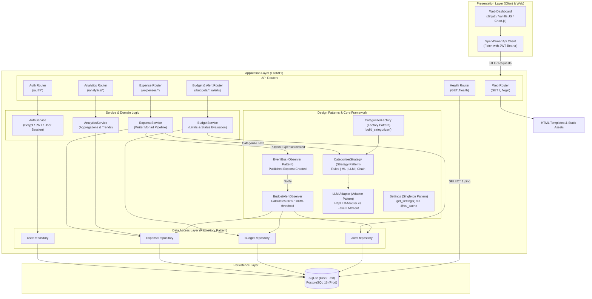
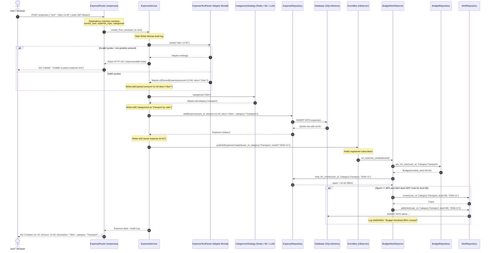

# SpendSmart — UML Architecture & Design Models (LC06)

> **Audience:** Evaluators, course instructors, and the SpendSmart development team.  
> **Author:** Sabuhi Garibov (Frontend, Tests & Documentation)  
> **Reference Document:** [`docs/TECH_TASK.md`](./TECH_TASK.md)

This document contains formal UML diagrams visualizing SpendSmart's modular architecture, runtime interactions, domain models, and design patterns (LC05, LC06, LC07, LC08).

---

## 1. System Component Diagram

SpendSmart employs a **layered architecture** (modular monolith) with high cohesion and low coupling. Routers handle HTTP translation and validation, services orchestrate business logic and design patterns, and repositories manage persistence against SQLAlchemy models.

---

## 2. Sequence Diagram: "Add Expense" Processing Pipeline

This diagram shows the complete lifecycle of adding an expense from plain text (`"Uber 12.40"`). It highlights the interplay between **FastAPI Dependency Injection**, the **`Maybe` monad** for parsing, the **Strategy pattern** for categorization, the **`Writer` monad** for audit logging, and the **Observer pattern** for budget threshold detection.

---

## 3. Class Diagram: Domain Models, Repositories & Design Patterns

This class diagram documents the entity relationships, repository interfaces, functional monads, and object-oriented design patterns required by LC07 and LC08.

```mermaid
classDiagram
  %% Domain Models (SQLAlchemy)
  class User {
    +int id
    +str email
    +str hashed_password
    +datetime created_at
  }

  class Category {
    <<enumeration>>
    Food
    Transport
    Subscriptions
    Shopping
    Bills
    Health
    Entertainment
    Other
  }

  class Expense {
    +int id
    +int user_id
    +Decimal amount
    +str description
    +str merchant
    +Category category
    +str category_source
    +date occurred_on
    +datetime created_at
  }

  class Budget {
    +int id
    +int user_id
    +Category category
    +Decimal monthly_limit
  }

  class Alert {
    +int id
    +int user_id
    +Category category
    +int level
    +str month
    +datetime created_at
  }

  %% Relationships
  User "1" --> "*" Expense : owns
  User "1" --> "*" Budget : sets
  User "1" --> "*" Alert : receives
  Expense --> Category : categorized as
  Budget --> Category : restricts
  Alert --> Category : warns for

  %% Repositories (Repository Pattern)
  class Repository~T~ {
    <<abstract>>
    #Session db
    #Type~T~ model
    +get(id: int) T
    +add(obj: T) T
    +delete(obj: T) void
    +list() List~T~
  }

  class ExpenseRepository {
    +list_for_user(user_id, month, category) List~Expense~
    +get_for_user(user_id, expense_id) Expense
    +total_for_month(user_id, category, month) Decimal
    +totals_by_category(user_id, month) Dict
    +totals_by_month(user_id, months) List
    +top_merchants(user_id, month, limit) List
  }

  class BudgetRepository {
    +get_for_user(user_id, category) Budget
    +list_for_user(user_id) List~Budget~
  }

  class AlertRepository {
    +exists(user_id, category, level, month) bool
    +list_for_user(user_id) List~Alert~
  }

  Repository <|-- ExpenseRepository
  Repository <|-- BudgetRepository
  Repository <|-- AlertRepository

  %% Strategy Pattern (Categorizer)
  class CategorizerStrategy {
    <<interface / Protocol>>
    +str name
    +categorize(description: str) Maybe~Category~
  }

  class RulesCategorizer {
    +str name = "rules"
    +categorize(description: str) Maybe~Category~
  }

  class MLCategorizer {
    +str name = "ml"
    -Pipeline model
    +categorize(description: str) Maybe~Category~
  }

  class LLMCategorizer {
    +str name = "llm"
    -LLMClient client
    +categorize(description: str) Maybe~Category~
  }

  class ChainCategorizer {
    +str name = "chain"
    -List~CategorizerStrategy~ strategies
    +categorize(description: str) Maybe~Category~
  }

  CategorizerStrategy <|.. RulesCategorizer
  CategorizerStrategy <|.. MLCategorizer
  CategorizerStrategy <|.. LLMCategorizer
  CategorizerStrategy <|.. ChainCategorizer

  %% Adapter Pattern (LLM Client)
  class LLMClient {
    <<interface / Protocol>>
    +complete(prompt: str) str
  }

  class HttpLLMAdapter {
    -str api_key
    -Client http_client
    +complete(prompt: str) str
  }

  class FakeLLMClient {
    +str fixed_response
    +complete(prompt: str) str
  }

  LLMClient <|.. HttpLLMAdapter
  LLMClient <|.. FakeLLMClient
  LLMCategorizer --> LLMClient : uses

  %% Observer Pattern (EventBus)
  class ExpenseCreated {
    <<dataclass>>
    +int user_id
    +Category category
    +str month
  }

  class EventBus {
    -Dict~Type, List~ handlers
    +subscribe(event_type, handler) void
    +publish(event) void
  }

  class BudgetAlertObserver {
    -BudgetRepository budget_repo
    -ExpenseRepository expense_repo
    -AlertRepository alert_repo
    +handle(event: ExpenseCreated) void
  }

  EventBus ..> ExpenseCreated : dispatches
  BudgetAlertObserver ..> ExpenseCreated : handles
  EventBus --> BudgetAlertObserver : notifies

  %% Monads (LC08)
  class Maybe~T~ {
    <<monad>>
    -_value: Optional~T~
    +of(value: T) Maybe~T~$
    +nothing() Maybe~T~$
    +map(f) Maybe
    +bind(f) Maybe
    +get_or_else(default: T) T
    +is_nothing() bool
  }

  class Writer~T~ {
    <<monad>>
    -_value: T
    -_log: List~str~
    +unit(value: T) Writer~T~$
    +tell(message: str) Writer~T~
    +bind(f) Writer
    +run() Tuple~T, List~str~~
  }

  %% Singleton Pattern
  class Settings {
    <<singleton>>
    +str app_env
    +str database_url
    +str jwt_secret
    +str categorizer
    +str log_level
  }
```

---

## 4. Key Design Patterns Mapping (LC07 & LC08)

| Pattern | Implementation Location | Responsibility | Demonstrable Behavior |
|---|---|---|---|
| **Strategy** | `app/ai/{base,rules,ml,llm}.py` | Interchangeable expense categorization algorithms. | Switch `CATEGORIZER=rules` or `CATEGORIZER=chain` in config without altering calling code. |
| **Factory** | `app/ai/factory.py` | Instantiates appropriate `CategorizerStrategy` based on application settings. | `build_categorizer("rules")` dynamically returns `RulesCategorizer`. |
| **Adapter** | `app/ai/llm.py` | Wraps real HTTP LLM API providers behind uniform `LLMClient` protocol. | Unit tests swap `HttpLLMAdapter` for `FakeLLMClient` with zero network overhead. |
| **Observer** | `app/core/events.py`, `app/budgets/observers.py` | Event-driven budget limit checking and alert dispatching. | Expense creation service does not import or couple to budget code; notifies via `EventBus`. |
| **Singleton** | `app/core/config.py` | Centralized, immutable environment settings. | `@lru_cache` on `get_settings()` guarantees single process-wide instance (`get_settings() is get_settings()`). |
| **Repository** | `app/repositories/*` | Encapsulates SQL queries and data mapping away from domain services. | Business services contain zero raw SQL statements. |
| **Maybe Monad** | `app/core/monads.py` | Functional container handling potential absent results cleanly. | Expense parser and categorizers chain operations without throwing `AttributeError: NoneType`. |
| **Writer Monad** | `app/core/monads.py` | Functional container accumulating an audit log alongside returned values. | Expense service emits an immutable step-by-step audit trail (`parsed -> categorized -> saved -> published`). |
