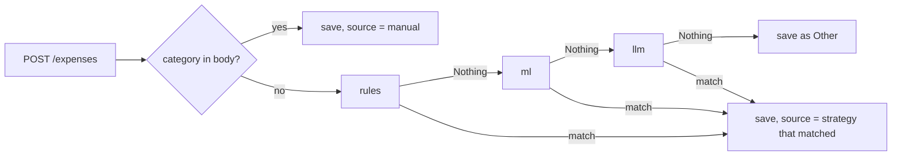

# AI and analytics

How expenses get their category (`app/ai/`), how the analytics endpoints
compute their numbers (`app/analytics/`), and the labelled data behind both
(`data/`). The contracts are in TECH_TASK §5.6, §6.5 and §7.4; this file covers
what the spec leaves open.

## Categorization

### How an expense gets its category

The expense service (Huseyn, `app/expenses/`) owns the decision and the database
write. `app/ai/` only answers "which category is this text?" and never touches
the database.

The `CATEGORIZER` setting picks what runs: `rules`, `ml`, `llm` or `chain`
(all three in the order above).

| File | Contents | Pattern |
|---|---|---|
| `app/ai/base.py` | `CategorizerStrategy` protocol | Strategy |
| `app/ai/rules.py` | `RulesCategorizer` | Strategy |
| `app/ai/ml.py` (#17) | `MLCategorizer` | Strategy |
| `app/ai/llm.py` (#18) | `LLMCategorizer`, `LLMClient`, `HttpLLMAdapter`, `FakeLLMClient` | Strategy, Adapter |
| `app/ai/factory.py` | `ChainCategorizer`, `build_categorizer`, `get_categorizer` | Factory, Chain of Responsibility |

### The strategies

**Rules.** All keywords are compiled into one regular expression: whole words
only, longest keyword first (so "Uber Eats" is Food, not Transport). The
description is lowercased before matching, so case doesn't matter and the
matched text is always a known keyword. Local merchants are listed in plain
Latin spelling (`azerishiq`, `bakikart`). `Other` has no keywords; it is what's
left when nothing matches.

Rules look at the store, not the item, so "Bravo umbrella" becomes Food. The
user can correct it by choosing the category, which is saved as `manual`.

**ML.** TF-IDF + Logistic Regression trained on `data/seed_expenses.csv` the
first time it is used, then kept in memory. Returns Nothing when the top
probability is below 0.5. Accuracy and the confusion matrix go in `docs/ml.md`,
measured twice: on a normal 80/20 split, and on merchants the model never saw in
training, which shows whether it learned the words or just memorized the names.

**LLM.** The prompt asks for exactly one of the eight category names. The reply
is trimmed and matched against `Category`. Anything else, a timeout or a missing
`LLM_API_KEY` gives Nothing. The key is never logged. Tests use
`FakeLLMClient` only, so no test touches the network.

A strategy that can't decide returns Nothing instead of raising. The chain then
moves on, and an LLM outage never stops an expense from being saved.

### Knowing which strategy decided

`categorize()` returns only the category, but the expense needs
`category_source` and the create pipeline logs `categorized as X by rules`.
`ChainCategorizer.categorize_with_source()` returns the category together with
the name of the strategy that matched. When a single strategy is configured,
its `name` is the source.

### Proposed: a `fallback` source

When every strategy returns Nothing, the expense is saved as `Other`. Saving
that as `rules` would be wrong, because no rule matched. Proposal: add
`fallback` to `CategorySource`. It is Farhad's model, and on an existing
Postgres database the column needs widening (`FALLBACK` is longer than
`MANUAL`), so this needs his approval before #12 uses it.

## Analytics (#19)

Every endpoint depends on `get_current_user` and passes `current_user.id` to
every repository call, so users only ever see their own data. Totals are
computed in SQL, not by loading rows into Python.

| Endpoint | Repository call | Done in the analytics service |
|---|---|---|
| `GET /analytics/summary?month=` | `summary_for_month` (new) and `totals_by_category` | `average = total / count`; an empty month gives zeros and `top_category: null` |
| `GET /analytics/by-category?month=` | `totals_by_category` | sort by total; percents rounded to one decimal with the largest-remainder method, so they add up to exactly 100 |
| `GET /analytics/trend?months=6` | `totals_by_month` | the repository skips empty months, so the service builds the list of the last N months and fills gaps with 0; future-dated expenses are left out |
| `GET /analytics/top-merchants?month=&limit=5` | `top_merchants` | nothing extra; when an expense has no merchant, its description is used |

`summary_for_month(user_id, month)` returns the month's total and count. It goes
in `app/repositories/expense_repo.py`, Farhad's file, so that PR needs his
review.

Input rules: `month` must be `YYYY-MM` (otherwise 422) and defaults to the
current month; `months` is 1–24; `limit` is 1–20. Amounts are computed as `Decimal` with 
two decimal places and sent as JSON numbers, matching the dashboard's mock data.

## Data (#15)

`data/seed_expenses.csv` has two columns, `description,category`: at least 200
rows, at least 15 per category, and only the eight `Category` values. It mixes
local merchants (Bravo, Araz, Bolt, Wolt, Azercell, Azərişıq, aptek) with
international ones (Netflix, Spotify, Uber, Starbucks).

For the ML evaluation the rows are split 80/20, stratified by category, with a
fixed random seed. Test rows are never used for training or for choosing rule
keywords, so the comparison between rules and ML stays fair.

## Later, if time allows

None of this is planned before the Dec 10 feature freeze. The eight main
categories stay fixed; anything new goes under one of them, or under Other.

- **Built-in subcategories** under the eight (Food → Groceries, Restaurants;
  Shopping → Clothes, Accessories), stored in one optional column on expenses.
  Rules could then let item words beat store words, so "Bravo umbrella" goes to
  Shopping → Accessories. Budgets, alerts and ML keep working on the eight.
- **User-created subcategories** under the same eight, in a per-user table. A
  general model can't know them, so they would be filled from the user's own
  corrections or by the LLM given the user's list.
- **A larger training set** from public transaction datasets, merged with the
  seed CSV through a download script rather than committed to the repo. Their
  labels have to be mapped onto the eight categories and their licenses
  checked. Local Azerbaijani rows stay a separate test set, so the score still
  shows how the model handles local spending.
- **Learning from manual corrections**, per user: if one user always moves
  "Bolt" to Transport, their next Bolt expense gets Transport automatically.
